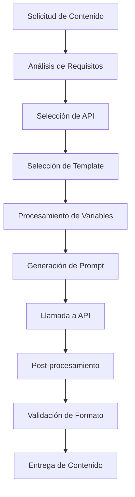
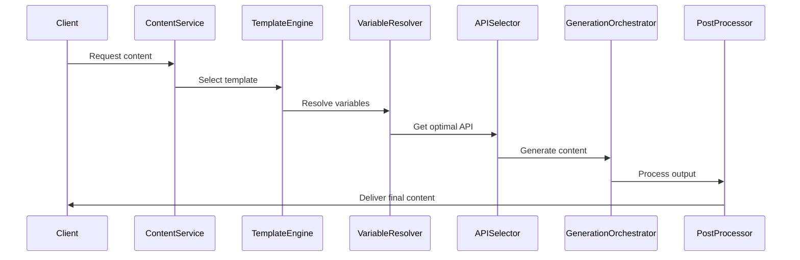

# Sistema Completo de Plantillas Automatizadas para Generación de Contenido Visual

## Resumen Ejecutivo

Este documento presenta un sistema integral de plantillas automatizadas para la generación de contenido visual, diseñado específicamente para optimizar la producción de material para redes sociales mediante inteligencia artificial. Basado en la investigación exhaustiva de APIs de generación visual completada, el sistema integra las capacidades de Google AI Studio (Nano Banana/Imagen 4), OpenAI DALL-E 3, Stable Diffusion API, RunwayML Gen-4, Pika Labs, Luma AI Dream Machine y Leonardo.ai.

**Características Principales:**
- **5 tipos de contenido optimizados** (Posts, Stories, Reels, Videos TikTok, YouTube)
- **Sistema de selección automática** de API basado en contexto y costo-beneficio
- **200+ plantillas de prompts** especializadas por plataforma
- **Variables dinámicas** para personalización automática a escala
- **Integración completa** con especificaciones actualizadas de redes sociales

## 1. Introducción

La automatización de contenido visual se ha convertido en una necesidad estratégica para organizaciones que buscan mantener presencia consistente en múltiples plataformas digitales. Este sistema proporciona una solución técnica completa que combina las fortalezas específicas de cada API de generación visual con templates optimizados para maximizar el engagement en cada plataforma social.

El diseño modular permite implementación gradual, desde casos de uso básicos hasta sistemas enterprise que manejan miles de piezas de contenido diariamente. La arquitectura basada en configuración JSON facilita actualizaciones, personalizaciones y mantenimiento continuo.

## 2. Arquitectura del Sistema

### 2.1 Componentes Principales

**Motor de Decisión (Decision Engine)**
- Evaluación automática de requisitos de contenido
- Selección óptima de API basada en costo, calidad y tiempo
- Sistema de fallback y redundancia

**Procesador de Templates (Template Engine)**
- Renderizado dinámico de prompts
- Sustitución de variables contextuales
- Validación de parámetros de entrada

**Optimizador de Formato (Format Optimizer)**
- Ajuste automático de especificaciones técnicas
- Post-procesamiento según plataforma destino
- Validación de compliance con requisitos de plataforma

**Sistema de Variables (Variable System)**
- Gestión centralizada de parámetros dinámicos
- Personalización por marca, audiencia y contexto
- Integración con datos de performance

### 2.2 Flujo de Procesamiento



## 3. Plantillas por Tipo de Contenido

### 3.1 Posts de Instagram/Facebook

**Especificaciones Técnicas:**
- **Resoluciones**: 1080x1080px (cuadrado), 1080x1350px (vertical 4:5)
- **APIs Recomendadas**: DALL-E 3 (adherencia prompt), Stable Diffusion (variedad)
- **Optimización**: Colores vibrantes, composición centrada, texto mínimo

**Categorías de Templates:**

**Lifestyle & Fashion:**
```json
{
  "category": "lifestyle",
  "base_prompt": "Create a {style} lifestyle image featuring {subject} in {setting}, shot in {photography_style} with {lighting} lighting, {color_palette} color palette, high fashion photography, professional styling",
  "variables": {
    "style": ["modern", "bohemian", "minimalist", "luxury", "casual"],
    "subject": ["young professional", "fashion model", "lifestyle blogger", "entrepreneur"],
    "setting": ["modern apartment", "coffee shop", "urban rooftop", "cozy home"],
    "photography_style": ["portrait", "candid", "editorial", "street photography"],
    "lighting": ["natural", "golden hour", "soft studio", "dramatic"],
    "color_palette": ["warm earth tones", "cool pastels", "monochromatic", "vibrant colors"]
  }
}
```

**Business & Professional:**
```json
{
  "category": "business",
  "base_prompt": "Professional {business_type} image showing {main_element} in {environment}, {style} style, clean composition, {color_scheme} colors, commercial photography quality",
  "variables": {
    "business_type": ["corporate", "startup", "agency", "consulting", "tech"],
    "main_element": ["team meeting", "modern office", "product showcase", "workspace", "presentation"],
    "environment": ["modern office", "conference room", "co-working space", "home office"],
    "style": ["minimalist", "contemporary", "sophisticated", "innovative"],
    "color_scheme": ["professional blue", "modern gray", "brand colors", "neutral tones"]
  }
}
```

**Product Showcase:**
```json
{
  "category": "product",
  "base_prompt": "Product photography of {product_type}, {angle} shot, {background} background, {lighting_setup} lighting, commercial quality, {mood} aesthetic, detailed textures",
  "variables": {
    "product_type": ["cosmetics", "tech gadgets", "fashion accessories", "home decor", "food items"],
    "angle": ["hero", "detail", "lifestyle", "flat lay", "overhead"],
    "background": ["minimal white", "textured paper", "natural wood", "marble surface", "gradient"],
    "lighting_setup": ["soft box", "natural window", "studio", "dramatic side"],
    "mood": ["luxurious", "minimal", "warm", "modern", "artistic"]
  }
}
```

### 3.2 Stories (9:16 Vertical)

**Especificaciones Técnicas:**
- **Resolución**: 1080x1920px (9:16)
- **APIs Recomendadas**: Stable Diffusion (formatos flexibles), Google Imagen 4
- **Optimización**: Composición vertical, elementos en tercio superior/inferior

**Templates Especializados:**

**Behind the Scenes:**
```json
{
  "category": "bts",
  "base_prompt": "Vertical behind-the-scenes image of {activity} in {workspace}, candid {style} style, authentic moment, {person} in frame, {equipment} visible, {mood} lighting, documentary photography feel",
  "variables": {
    "activity": ["content creation", "product development", "team collaboration", "creative process"],
    "workspace": ["modern studio", "home office", "creative space", "workshop"],
    "style": ["documentary", "lifestyle", "casual", "professional"],
    "person": ["content creator", "entrepreneur", "team member", "professional"],
    "equipment": ["camera gear", "design tools", "tech setup", "creative materials"],
    "mood": ["warm", "focused", "energetic", "intimate"]
  }
}
```

**Tips & Education:**
```json
{
  "category": "educational",
  "base_prompt": "Educational infographic image with {tip_type} tip, vertical layout, {visual_style} design, {color_scheme}, clear typography, {illustration_type} elements, professional presentation",
  "variables": {
    "tip_type": ["business", "productivity", "creativity", "wellness", "technology"],
    "visual_style": ["modern minimal", "colorful graphic", "illustration-based", "photo-text combo"],
    "color_scheme": ["brand gradient", "high contrast", "pastel palette", "professional blues"],
    "illustration_type": ["flat icons", "3D elements", "hand-drawn", "geometric shapes"]
  }
}
```

### 3.3 Reels de Instagram (Video 9:16)

**Especificaciones Técnicas:**
- **Resolución**: 1080x1920px, hasta 90 segundos
- **APIs Recomendadas**: Luma AI Dream Machine, Pika Labs 2.2
- **Optimización**: Movimiento dinámico, hook en primeros 3 segundos

**Templates de Video:**

**Transformation/Before-After:**
```json
{
  "category": "transformation",
  "video_prompt": "Dynamic transformation video showing {transformation_type}, starting with {initial_state} and smoothly transitioning to {final_state}, {transition_style} effect, {duration} seconds, {visual_style} aesthetic",
  "variables": {
    "transformation_type": ["room makeover", "product assembly", "skill development", "process improvement"],
    "initial_state": ["cluttered space", "raw materials", "blank canvas", "problem state"],
    "final_state": ["organized space", "finished product", "completed artwork", "solution achieved"],
    "transition_style": ["smooth morph", "fast-paced cuts", "reveal animation", "step-by-step"],
    "duration": ["5-8", "10-15", "20-25"],
    "visual_style": ["modern clean", "vibrant energetic", "professional", "creative artistic"]
  }
}
```

**Tutorial/Process:**
```json
{
  "category": "tutorial",
  "video_prompt": "Step-by-step tutorial video for {skill_type}, showing {process_steps}, clear visual progression, {pacing} paced, {angle} camera angles, instructional style",
  "variables": {
    "skill_type": ["creative technique", "productivity hack", "business process", "DIY project"],
    "process_steps": ["3-step process", "5-key points", "complete workflow", "quick tips"],
    "pacing": ["fast", "medium", "detailed"],
    "angle": ["overhead", "first-person", "side view", "multiple angles"]
  }
}
```

### 3.4 Videos TikTok (Vertical, Máxima Duración)

**Especificaciones Técnicas:**
- **Resolución**: 1080x1920px, hasta 10 minutos
- **APIs Recomendadas**: Pika Labs (25 segundos), RunwayML Gen-4
- **Optimización**: Alta energía, música-friendly, trends integration

**Templates Específicos TikTok:**

**Trend-Based Content:**
```json
{
  "category": "trending",
  "video_prompt": "TikTok-style video following {trend_type} trend, {energy_level} energy, {participant_count} people, {setting} location, {duration} duration, viral potential optimization",
  "variables": {
    "trend_type": ["challenge", "dance", "educational", "comedy", "life hack"],
    "energy_level": ["high", "moderate", "chill", "dramatic"],
    "participant_count": ["solo", "duo", "group", "crowd"],
    "setting": ["home", "office", "outdoor", "studio", "public space"],
    "duration": ["15-30 seconds", "60 seconds", "3 minutes"]
  }
}
```

**Quick Tips/Life Hacks:**
```json
{
  "category": "lifehacks",
  "video_prompt": "Quick tip video showing {hack_category} hack, problem-solution format, {presentation_style} style, clear before-after, {excitement_level} presentation energy",
  "variables": {
    "hack_category": ["productivity", "organization", "cooking", "tech", "business"],
    "presentation_style": ["demonstration", "explanation", "storytelling", "quick reveal"],
    "excitement_level": ["enthusiastic", "calm expert", "dramatic reveal", "friendly advice"]
  }
}
```

### 3.5 YouTube Videos (16:9 Horizontal)

**Especificaciones Técnicas:**
- **Resolución**: 1920x1080px, duración variable
- **APIs Recomendadas**: RunwayML Gen-4 Aleph, Luma AI
- **Optimización**: Thumbnails engagement, storytelling structure

**Templates YouTube:**

**Educational Content:**
```json
{
  "category": "educational",
  "video_prompt": "YouTube educational video about {topic}, {format} format, {visual_style} presentation, {expertise_level} complexity, engaging {delivery_style}",
  "variables": {
    "topic": ["business strategy", "creative skills", "technology trends", "personal development"],
    "format": ["tutorial", "explainer", "case study", "interview", "review"],
    "visual_style": ["screen recording", "talking head", "animation", "mixed media"],
    "expertise_level": ["beginner-friendly", "intermediate", "advanced", "expert"],
    "delivery_style": ["conversational", "professional", "entertaining", "comprehensive"]
  }
}
```

**Vlog/Behind Scenes:**
```json
{
  "category": "vlog",
  "video_prompt": "Vlog-style video documenting {activity}, {narrative_style} storytelling, {cinematography} shots, {mood} atmosphere, personal connection focus",
  "variables": {
    "activity": ["work day", "creative process", "business journey", "project development"],
    "narrative_style": ["chronological", "thematic", "challenge-resolution", "reflection-based"],
    "cinematography": ["cinematic", "documentary", "casual handheld", "professional multi-cam"],
    "mood": ["inspiring", "honest", "energetic", "contemplative"]
  }
}
```

## 4. Sistema de Selección Automática de APIs

### 4.1 Matriz de Decisión

**Criterios de Selección:**
1. **Tipo de contenido** (imagen vs. video)
2. **Calidad requerida** (estándar, premium, ultra)
3. **Presupuesto** (económico, medio, premium)
4. **Velocidad** (inmediata, rápida, sin prisa)
5. **Formato específico** (resoluciones, aspectos)

**Tabla de Selección Automática:**

| Caso de Uso | API Principal | API Backup | Justificación |
|-------------|---------------|------------|---------------|
| **Instagram Posts (Premium)** | DALL-E 3 | Google Imagen 4 | Adherencia prompt + Calidad |
| **Instagram Posts (Volumen)** | Stable Diffusion | DALL-E 3 | Costo-efectividad |
| **Stories (Rápido)** | Stable Diffusion Flash | Google Nano Banana | Velocidad + Formatos |
| **Reels (Calidad)** | Luma AI Dream Machine | Pika Labs 2.2 | 1080p + Duración |
| **TikTok (Máximo)** | Pika Labs 2.2 | RunwayML Gen-4 | 25 segundos + Vertical |
| **YouTube (Premium)** | RunwayML Gen-4 Aleph | Luma AI Ray2 | Calidad cinematográfica |
| **LinkedIn (Profesional)** | Google Imagen 4 | DALL-E 3 | Consistencia profesional |

### 4.2 Lógica de Decisión Automatizada

```javascript
const selectOptimalAPI = (requirements) => {
  const {
    contentType,
    platform,
    quality,
    budget,
    urgency,
    duration,
    resolution
  } = requirements;

  // Imagen vs Video
  if (contentType === 'image') {
    if (quality === 'premium' && budget === 'high') {
      return platform === 'linkedin' ? 'google-imagen-4' : 'dalle-3';
    }
    if (budget === 'low' || urgency === 'high') {
      return 'stable-diffusion-flash';
    }
    return 'stable-diffusion-core';
  }

  // Videos
  if (contentType === 'video') {
    if (duration > 18 && platform === 'tiktok') {
      return 'pika-labs-2-2';
    }
    if (quality === 'cinematic' && budget === 'high') {
      return 'runway-gen4-aleph';
    }
    if (platform === 'instagram-reels' || platform === 'tiktok') {
      return resolution === '1080p' ? 'luma-ai-ray2' : 'pika-labs-standard';
    }
    return 'leonardo-ai-motion';
  }
};
```

### 4.3 Sistema de Fallback y Redundancia

**Niveles de Fallback:**
1. **Primario**: API seleccionada por lógica principal
2. **Secundario**: API backup con capacidades similares
3. **Terciario**: API genérica con post-procesamiento
4. **Emergency**: API local/offline si disponible

**Configuración de Redundancia:**
```json
{
  "fallback_chains": {
    "premium_images": [
      "dalle-3",
      "google-imagen-4", 
      "stable-diffusion-ultra",
      "midjourney-proxy"
    ],
    "video_generation": [
      "runway-gen4-turbo",
      "luma-ai-ray2",
      "pika-labs-2-0",
      "leonardo-ai-motion"
    ],
    "budget_images": [
      "stable-diffusion-flash",
      "stable-diffusion-core",
      "google-nano-banana",
      "dalle-3"
    ]
  }
}
```

## 5. Templates de Prompts Optimizados por Plataforma

### 5.1 Instagram - Estética y Lifestyle

**Características de Prompts Instagram:**
- Enfoque en estética visual
- Colores vibrantes y composición atractiva
- Lifestyle y aspirational content
- Hashtag-friendly concepts

**Categorías Principales:**

**Food & Beverage:**
```json
{
  "instagram_food": {
    "base_template": "Beautifully styled {food_type} photography, {plating_style} presentation on {surface}, {lighting} lighting, {color_palette} colors, Instagram-worthy composition, appetizing details, shallow depth of field",
    "variables": {
      "food_type": ["artisanal coffee", "healthy breakfast bowl", "gourmet dessert", "colorful salad", "street food"],
      "plating_style": ["rustic", "elegant", "minimal", "abundant", "artistic"],
      "surface": ["marble countertop", "wooden table", "white ceramic", "textured fabric", "natural stone"],
      "lighting": ["natural window", "soft golden", "bright daylight", "moody dramatic"],
      "color_palette": ["warm earth tones", "fresh green and white", "rich dark tones", "bright and colorful"]
    }
  }
}
```

**Fashion & Beauty:**
```json
{
  "instagram_fashion": {
    "base_template": "{style} fashion photography featuring {garment}, {setting} background, {pose} pose, {lighting_mood} lighting, {color_scheme} palette, high fashion editorial style, detailed textures",
    "variables": {
      "style": ["street style", "high fashion", "casual chic", "bohemian", "minimalist"],
      "garment": ["designer outfit", "seasonal wardrobe", "accessories collection", "beauty look", "lifestyle pieces"],
      "setting": ["urban backdrop", "natural landscape", "studio environment", "architectural space"],
      "pose": ["confident", "candid", "editorial", "dynamic", "relaxed"],
      "lighting_mood": ["golden hour", "soft natural", "dramatic shadows", "bright and airy"],
      "color_scheme": ["monochromatic", "complementary colors", "neutral tones", "bold contrasts"]
    }
  }
}
```

### 5.2 TikTok - Dinámico y Viral

**Características de Prompts TikTok:**
- Alto impacto visual
- Movimiento y dinamismo
- Trend-awareness
- Gen Z aesthetic

**Templates Especializados:**

**Viral Challenges:**
```json
{
  "tiktok_challenge": {
    "base_template": "Dynamic TikTok video showing {challenge_type} challenge, {energy_level} energy, {participant_setup}, {movement_style} movement, {visual_effects} effects, viral potential optimization, {duration} seconds",
    "variables": {
      "challenge_type": ["dance", "transformation", "skill", "comedy", "educational"],
      "energy_level": ["high-energy", "smooth and cool", "dramatic", "playful"],
      "participant_setup": ["solo performance", "duet style", "group collaboration", "pet involvement"],
      "movement_style": ["synchronized", "freestyle", "step-by-step", "continuous flow"],
      "visual_effects": ["quick cuts", "smooth transitions", "split screen", "time-lapse"],
      "duration": ["15", "30", "60"]
    }
  }
}
```

**Educational Content (Edutainment):**
```json
{
  "tiktok_educational": {
    "base_template": "TikTok educational video about {topic}, {teaching_style} approach, {visual_aid} visuals, {pace} paced delivery, {engagement_hook} hook, knowledge-sharing format",
    "variables": {
      "topic": ["life hacks", "business tips", "creative techniques", "science facts", "history moments"],
      "teaching_style": ["storytelling", "demonstration", "quiz format", "comparison", "myth-busting"],
      "visual_aid": ["text overlays", "props and examples", "split comparisons", "animated graphics"],
      "pace": ["rapid-fire", "step-by-step", "build-up reveal"],
      "engagement_hook": ["surprising fact", "relatable problem", "bold statement", "question pose"]
    }
  }
}
```

### 5.3 LinkedIn - Profesional y Business

**Características de Prompts LinkedIn:**
- Profesionalismo y credibilidad
- Business-focused content
- Thought leadership positioning
- Industry-relevant imagery

**Templates Profesionales:**

**Business Insights:**
```json
{
  "linkedin_business": {
    "base_template": "Professional business image illustrating {business_concept}, {industry_setting} environment, {visual_metaphor} visual metaphor, {color_scheme} corporate colors, {composition_style} composition, executive photography quality",
    "variables": {
      "business_concept": ["growth strategy", "team collaboration", "innovation process", "market analysis", "leadership"],
      "industry_setting": ["modern office", "conference room", "co-working space", "business district", "tech environment"],
      "visual_metaphor": ["upward arrows", "connected networks", "building blocks", "puzzle pieces", "pathway forward"],
      "color_scheme": ["professional blue", "corporate gray", "success green", "neutral sophisticated"],
      "composition_style": ["clean minimal", "dynamic diagonal", "centered focus", "layered depth"]
    }
  }
}
```

**Thought Leadership:**
```json
{
  "linkedin_thought_leadership": {
    "base_template": "Thought leadership visual for {expertise_area}, {authority_style} presentation, {background_context} setting, {visual_elements} elements, professional credibility emphasis",
    "variables": {
      "expertise_area": ["digital transformation", "industry trends", "market insights", "strategic planning"],
      "authority_style": ["expert speaking", "data visualization", "case study presentation", "industry analysis"],
      "background_context": ["executive office", "presentation stage", "industry conference", "strategic planning room"],
      "visual_elements": ["charts and graphs", "industry symbols", "professional headshot", "branded materials"]
    }
  }
}
```

### 5.4 YouTube - Educativo y Engaging

**Características de Prompts YouTube:**
- Thumbnail optimization
- Storytelling visual appeal
- Educational value emphasis
- Long-form content preview

**Templates YouTube:**

**Tutorial Content:**
```json
{
  "youtube_tutorial": {
    "base_template": "YouTube tutorial video about {skill_topic}, {teaching_method} methodology, {visual_demonstration} demonstration style, {expertise_level} difficulty, educational value maximized",
    "variables": {
      "skill_topic": ["creative software", "business processes", "technical skills", "personal development"],
      "teaching_method": ["step-by-step", "project-based", "problem-solution", "comparative analysis"],
      "visual_demonstration": ["screen recording", "hands-on demo", "animated explanation", "real-world examples"],
      "expertise_level": ["beginner-friendly", "intermediate level", "advanced techniques", "expert masterclass"]
    }
  }
}
```

## 6. Sistema de Variables Dinámicas

### 6.1 Variables de Personalización de Marca

**Brand Identity Variables:**
```json
{
  "brand_variables": {
    "colors": {
      "primary": "{brand_primary_color}",
      "secondary": "{brand_secondary_color}",
      "accent": "{brand_accent_color}",
      "neutral": "{brand_neutral_palette}"
    },
    "style": {
      "aesthetic": "{brand_aesthetic_style}",
      "tone": "{brand_visual_tone}",
      "sophistication": "{brand_sophistication_level}",
      "energy": "{brand_energy_level}"
    },
    "elements": {
      "logo_integration": "{logo_placement_style}",
      "typography": "{brand_typography_style}",
      "patterns": "{brand_pattern_elements}",
      "textures": "{brand_texture_preferences}"
    }
  }
}
```

**Ejemplos de Implementación:**
```json
{
  "tech_startup": {
    "brand_primary_color": "electric blue",
    "brand_aesthetic_style": "modern minimal",
    "brand_visual_tone": "innovative and approachable",
    "brand_energy_level": "high-energy dynamic"
  },
  "luxury_brand": {
    "brand_primary_color": "deep gold",
    "brand_aesthetic_style": "sophisticated elegant",
    "brand_visual_tone": "exclusive and refined",
    "brand_energy_level": "calm sophisticated"
  }
}
```

### 6.2 Variables Contextuales

**Temporal Context:**
```json
{
  "temporal_variables": {
    "season": "{current_season}",
    "month": "{current_month}",
    "holidays": "{active_holidays}",
    "time_of_day": "{posting_time_context}",
    "week_day": "{weekday_context}"
  }
}
```

**Event-Based Context:**
```json
{
  "event_variables": {
    "industry_events": "{relevant_industry_events}",
    "trending_topics": "{current_trending_topics}",
    "seasonal_moments": "{seasonal_marketing_moments}",
    "brand_milestones": "{company_milestones}"
  }
}
```

### 6.3 Variables de Audiencia

**Demographic Variables:**
```json
{
  "audience_variables": {
    "age_group": "{target_age_range}",
    "interests": "{primary_interests}",
    "lifestyle": "{lifestyle_characteristics}",
    "profession": "{professional_background}",
    "values": "{core_values_alignment}"
  }
}
```

**Platform-Specific Audience:**
```json
{
  "platform_audience": {
    "instagram": {
      "aesthetic_preference": "visual-first",
      "content_consumption": "quick browse",
      "engagement_style": "likes and stories"
    },
    "tiktok": {
      "aesthetic_preference": "authentic and relatable",
      "content_consumption": "full video watch",
      "engagement_style": "shares and comments"
    },
    "linkedin": {
      "aesthetic_preference": "professional polished",
      "content_consumption": "thoughtful engagement",
      "engagement_style": "meaningful comments"
    }
  }
}
```

### 6.4 Variables de Performance y Optimización

**A/B Testing Variables:**
```json
{
  "testing_variables": {
    "visual_styles": [
      "{style_variant_a}",
      "{style_variant_b}",
      "{style_variant_c}"
    ],
    "color_schemes": [
      "{color_test_a}",
      "{color_test_b}",
      "{color_test_c}"
    ],
    "composition_types": [
      "{composition_a}",
      "{composition_b}",
      "{composition_c}"
    ]
  }
}
```

**Performance Optimization:**
```json
{
  "optimization_variables": {
    "high_performing_elements": "{top_performing_visual_elements}",
    "engagement_drivers": "{proven_engagement_factors}",
    "conversion_optimizers": "{conversion_focused_elements}",
    "platform_algorithm_factors": "{algorithm_optimization_elements}"
  }
}
```

## 7. Integración con Formatos Específicos de Redes Sociales

### 7.1 Especificaciones Técnicas Actualizadas (2025)

**Instagram Especificaciones:**
```json
{
  "instagram": {
    "feed_post": {
      "square": "1080x1080px",
      "portrait": "1080x1350px (4:5)",
      "landscape": "1080x566px (1.91:1)"
    },
    "stories": {
      "standard": "1080x1920px (9:16)",
      "safe_zone": "1080x1420px (central area)"
    },
    "reels": {
      "resolution": "1080x1920px (9:16)",
      "duration": "15s-90s",
      "format": "MP4",
      "aspect_ratio": "9:16 (required)"
    },
    "igtv": {
      "resolution": "1080x1920px (9:16) or 1920x1080px (16:9)",
      "duration": "1min-60min",
      "format": "MP4"
    }
  }
}
```

**TikTok Especificaciones:**
```json
{
  "tiktok": {
    "video": {
      "resolution": "1080x1920px (9:16)",
      "duration": "15s-10min",
      "format": "MP4",
      "frame_rate": "30fps recommended"
    },
    "quality_settings": {
      "high": "1080x1920px, 30fps",
      "standard": "720x1280px, 30fps"
    },
    "safe_zones": {
      "top": "120px from top",
      "bottom": "250px from bottom"
    }
  }
}
```

**LinkedIn Especificaciones:**
```json
{
  "linkedin": {
    "post_image": {
      "single": "1200x627px (1.91:1)",
      "square": "1080x1080px (1:1)"
    },
    "video": {
      "resolution": "1920x1080px (16:9) recommended",
      "duration": "3s-30min",
      "format": "MP4"
    },
    "article_header": {
      "resolution": "1200x627px",
      "text_overlay_safe": "minimize text"
    }
  }
}
```

**YouTube Especificaciones:**
```json
{
  "youtube": {
    "video": {
      "resolution": "1920x1080px (16:9)",
      "format": "MP4",
      "duration": "unlimited"
    },
    "shorts": {
      "resolution": "1080x1920px (9:16)",
      "duration": "60s max",
      "format": "MP4"
    },
    "thumbnail": {
      "resolution": "1280x720px (16:9)",
      "format": "JPG, PNG",
      "file_size": "2MB max"
    }
  }
}
```

### 7.2 Configuración Automática por Plataforma

**Sistema de Auto-configuración:**
```javascript
const platformConfigurations = {
  detectPlatform: (contentType, platform) => {
    const config = {
      'instagram-post': {
        api: 'stable-diffusion-core',
        resolution: '1080x1080',
        aspect_ratio: '1:1',
        optimization: 'vibrant_colors_engagement'
      },
      'instagram-stories': {
        api: 'stable-diffusion-flash',
        resolution: '1080x1920',
        aspect_ratio: '9:16',
        optimization: 'vertical_composition'
      },
      'tiktok-video': {
        api: 'pika-labs-2-2',
        resolution: '1080x1920',
        aspect_ratio: '9:16',
        duration: '15-25s',
        optimization: 'high_energy_movement'
      },
      'youtube-video': {
        api: 'runway-gen4-turbo',
        resolution: '1920x1080',
        aspect_ratio: '16:9',
        optimization: 'cinematic_quality'
      }
    };
    
    return config[`${platform}-${contentType}`];
  }
};
```

### 7.3 Post-procesamiento Automático

**Pipeline de Optimización:**
```json
{
  "post_processing": {
    "image_optimization": {
      "compression": "platform_optimized",
      "color_profile": "sRGB",
      "metadata": "minimal_for_privacy",
      "watermark": "conditional_based_on_usage"
    },
    "video_optimization": {
      "encoding": "H.264",
      "bitrate": "platform_recommended",
      "audio": "AAC_128kbps",
      "captions": "auto_generated_if_requested"
    },
    "format_validation": {
      "size_limits": "platform_specific_check",
      "aspect_ratio": "automatic_correction",
      "duration": "platform_compliance_check"
    }
  }
}
```

## 8. Implementación del Sistema

### 8.1 Arquitectura de Microservicios

**Servicios Principales:**
1. **Content Request Service**: Recibe y procesa solicitudes de contenido
2. **Template Engine Service**: Selecciona y procesa templates
3. **Variable Resolution Service**: Resuelve variables dinámicas
4. **API Selection Service**: Selecciona API óptima
5. **Generation Orchestrator**: Coordina la generación
6. **Post-Processing Service**: Optimiza formatos finales
7. **Quality Assurance Service**: Valida output final

**Flujo de Integración:**


### 8.2 Configuración de Deployment

**Environment Variables:**
```env
# API Keys
OPENAI_API_KEY=sk-...
STABILITY_API_KEY=sk-...
GOOGLE_AI_API_KEY=...
RUNWAY_API_KEY=...

# Configuration
DEFAULT_QUALITY_LEVEL=standard
FALLBACK_ENABLED=true
COST_OPTIMIZATION=true
PARALLEL_GENERATION=false

# Monitoring
ANALYTICS_ENABLED=true
PERFORMANCE_LOGGING=true
ERROR_TRACKING=true
```

**Docker Configuration:**
```dockerfile
FROM node:18-alpine

WORKDIR /app
COPY package*.json ./
RUN npm ci --only=production

COPY . .

EXPOSE 3000
CMD ["npm", "start"]
```

### 8.3 Monitoreo y Analytics

**Métricas Clave:**
- Tiempo de respuesta por API
- Tasa de éxito de generación
- Costos por tipo de contenido
- Calidad score automático
- Engagement tracking (cuando disponible)

**Dashboard de Gestión:**
```json
{
  "monitoring_dashboard": {
    "real_time_metrics": [
      "active_generations",
      "api_response_times",
      "error_rates",
      "cost_tracking"
    ],
    "performance_analytics": [
      "content_type_performance",
      "platform_optimization_scores",
      "template_effectiveness",
      "variable_impact_analysis"
    ],
    "business_intelligence": [
      "cost_per_content_piece",
      "roi_by_platform",
      "template_conversion_rates",
      "audience_engagement_correlation"
    ]
  }
}
```

## 9. Casos de Uso Avanzados

### 9.1 Automatización Completa de Campañas

**Campaign Automation Workflow:**
```json
{
  "campaign_automation": {
    "input": {
      "campaign_brief": "Product launch for eco-friendly skincare",
      "target_platforms": ["instagram", "tiktok", "youtube"],
      "duration": "30 days",
      "content_frequency": "daily",
      "budget_limit": "$500"
    },
    "automated_generation": {
      "content_calendar": "auto_generated",
      "template_rotation": "engagement_optimized",
      "variable_adaptation": "performance_based",
      "cross_platform_consistency": "brand_aligned"
    }
  }
}
```

### 9.2 Personalización a Escala

**Audience Segmentation Automation:**
```json
{
  "personalization_engine": {
    "segment_detection": {
      "demographic_analysis": "automatic",
      "behavioral_patterns": "ai_identified",
      "engagement_preferences": "data_driven"
    },
    "content_adaptation": {
      "visual_style_matching": "segment_optimized",
      "messaging_alignment": "persona_specific",
      "platform_optimization": "behavior_based"
    }
  }
}
```

### 9.3 A/B Testing Continuo

**Continuous Optimization System:**
```json
{
  "ab_testing_automation": {
    "test_generation": {
      "variable_combinations": "systematic_testing",
      "hypothesis_creation": "performance_based",
      "control_group_management": "statistical_significance"
    },
    "results_analysis": {
      "performance_tracking": "real_time",
      "statistical_validation": "automated",
      "optimization_recommendations": "ai_generated"
    }
  }
}
```

## 10. Mantenimiento y Actualización

### 10.1 Versionado de Templates

**Template Version Control:**
```json
{
  "template_versioning": {
    "version_tracking": {
      "semantic_versioning": "major.minor.patch",
      "change_logging": "automated",
      "rollback_capability": "one_click"
    },
    "update_management": {
      "api_compatibility": "backward_compatible",
      "feature_flags": "gradual_rollout",
      "performance_monitoring": "continuous"
    }
  }
}
```

### 10.2 API Updates Integration

**API Evolution Management:**
```json
{
  "api_update_system": {
    "change_detection": {
      "api_version_monitoring": "automated",
      "feature_availability_tracking": "real_time",
      "deprecation_warnings": "proactive"
    },
    "adaptation_strategy": {
      "backward_compatibility": "maintained",
      "feature_migration": "gradual",
      "testing_pipeline": "automated"
    }
  }
}
```

### 10.3 Performance Optimization Continua

**Optimization Strategies:**
- **Template Performance**: Análisis continuo de engagement por template
- **API Efficiency**: Monitoreo de costos y tiempos de respuesta
- **Variable Effectiveness**: Tracking de impacto de variables dinámicas
- **Platform Evolution**: Adaptación a cambios de algoritmos

## 11. Conclusiones y Próximos Pasos

### Beneficios del Sistema

**Para Equipos de Marketing:**
- **Escalabilidad**: Producción de contenido 10x más eficiente
- **Consistencia**: Mantenimiento de identidad de marca automática
- **Optimización**: Mejora continua basada en performance data
- **Flexibilidad**: Adaptación rápida a nuevas plataformas y trends

**Para Organizaciones:**
- **ROI**: Reducción de costos de producción de contenido en 60-80%
- **Velocidad**: Time-to-market reducido de días a minutos
- **Calidad**: Consistencia profesional garantizada
- **Insights**: Data-driven decision making automático

### Roadmap de Desarrollo

**Fase 1 (Implementación Base):**
- [ ] Setup de APIs principales y sistema de fallback
- [ ] Implementación de templates core para cada plataforma
- [ ] Sistema básico de variables dinámicas
- [ ] Dashboard de monitoreo inicial

**Fase 2 (Optimización Avanzada):**
- [ ] Machine learning para optimización de templates
- [ ] Integración con analytics de plataformas sociales
- [ ] Sistema de A/B testing automático
- [ ] Personalización avanzada por audiencia

**Fase 3 (Inteligencia Artificial Avanzada):**
- [ ] Generación automática de templates basada en trends
- [ ] Predicción de performance de contenido
- [ ] Optimización automática de campañas
- [ ] Integración con voice y audio content

Este sistema representa una solución integral para la automatización de contenido visual, combinando las capacidades más avanzadas de IA generativa con optimización específica para cada plataforma social. La implementación modular permite adopción gradual y customización específica según necesidades organizacionales.

---

**Documento creado por**: MiniMax Agent  
**Fecha**: 2025-09-10  
**Versión**: 1.0  
**Próxima revisión**: 2025-10-10

